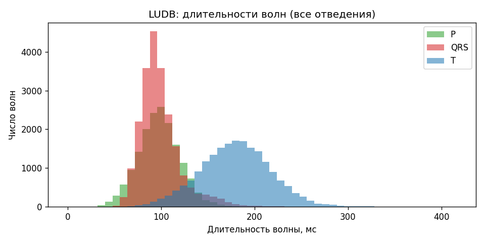
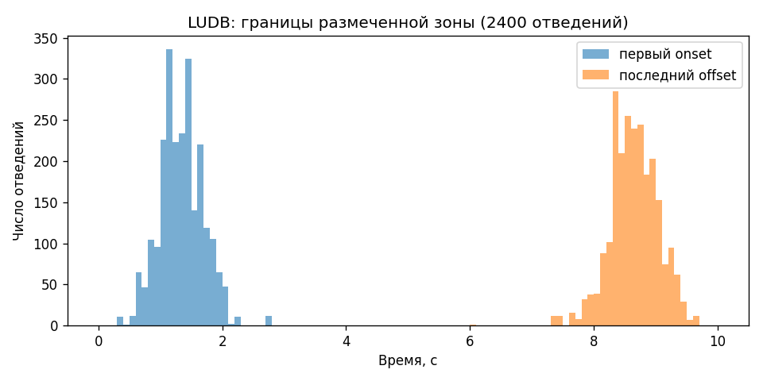
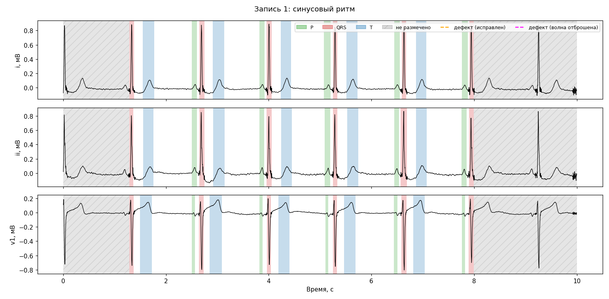
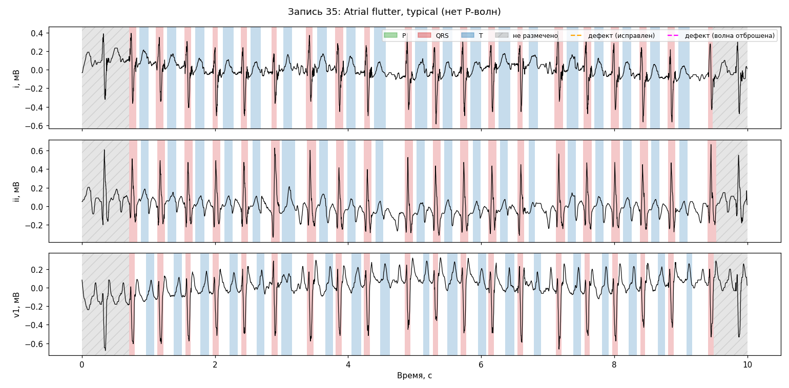
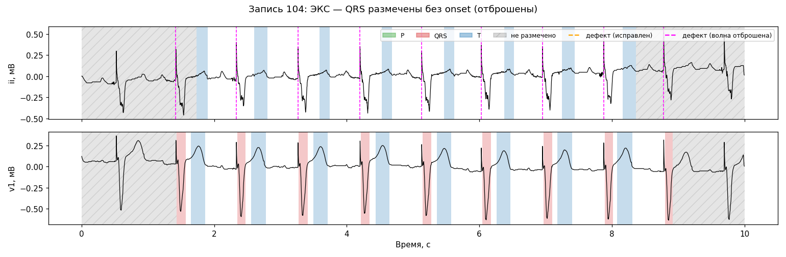
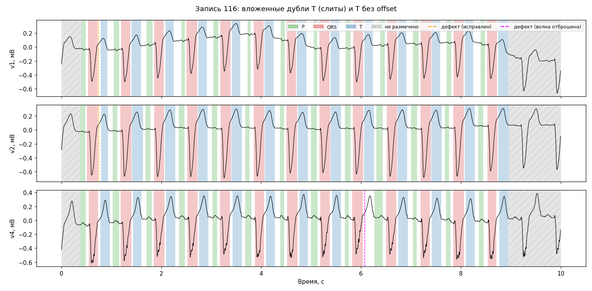

# LUDB: отчёт о данных

Сгенерировано `data/ludb_report.py`. Особенности разметки и выводы — [docs/research/R1_ludb.md](../../docs/research/R1_ludb.md).

## Сверка с публикацией и README

| Проверка | Ожидание | Факт | |
|---|---|---|---|
| Число записей | 200 | 200 | PASS |
| Форма сигнала (отведения × отсчёты) | {(12, 5000)} | {(12, 5000)} | PASS |
| У каждого отведения есть разметка | True | True | PASS |
| Волн P (символов пика, допуск 0.1%) | 16797 | 16797 | PASS |
| Волн QRS (символов пика, допуск 0.1%) | 21966 | 21965 | PASS |
| Волн T (символов пика, допуск 0.1%) | 19666 | 19661 | PASS |
| Волн всего (символов пика, допуск 0.1%) | 58429 | 58423 | PASS |
| Пол Ж / М | {'F': 85, 'M': 115} | {'F': 85, 'M': 115} | PASS |
| Возраст min–max, среднее | 11–90, ≈52 | 11–90, 52.0 | PASS |
| Ритмы (первый в списке) = таблица README | {'Sinus rhythm': 143, 'Sinus tachycardia': 4, 'Sinus bradycardia': 25, 'Sinus arrhythmia': 8, 'Irregular sinus rhythm': 2, 'Atrial fibrillation': 15, 'Atrial flutter, typical': 3} | {'Sinus bradycardia': 25, 'Sinus rhythm': 143, 'Atrial fibrillation': 15, 'Sinus arrhythmia': 8, 'Atrial flutter, typical': 3, 'Sinus tachycardia': 4, 'Irregular sinus rhythm': 2} | PASS |

## Разобранные волны

Публикация считает волны по символам пиков. Модуль `yolo_1d.utils.ludb` возвращает только волны, из которых строится отрезок [onset, offset]: дефектные исправляются или отбрасываются.

В файлах разметки LUDB v1.0.1 символов пика **58 423**, тогда как README и статья указывают 58 429 (QRS 21 966 → 21 965, T 19 666 → 19 661, P совпадает). Расхождение есть в исходных файлах, оно не связано с чтением: символы считаются напрямую через `wfdb.rdann`.

| Класс | Символов пика | Волн после разбора | Разница |
|---|---|---|---|
| P | 16797 | 16797 | 0 |
| QRS | 21965 | 21861 | -104 |
| T | 19661 | 19652 | -9 |
| Всего | 58423 | 58310 | -113 |

Разница складывается из дефектов ниже: отброшенные волны (`отброшены`) уменьшают счёт на 1 каждая, `merged_duplicates` сливает k вложенных копий одной волны в одну (−(k−1)).

### Дефекты разметки

| Вид | Число | Записи |
|---|---|---|
| merged_duplicates | 2 | 116 |
| missing_offset (отброшены) | 1 | 116 |
| missing_onset (отброшены) | 103 | 7, 34, 95, 104, 111 |
| no_peak (отброшены) | 2 | 8 |
| peak_before_onset | 19 | 7, 34, 111, 198 |
| unparsed (отброшены) | 1 | 8 |

**Отведений с отброшенными волнами: 24** — в сигнале внутри размеченной зоны есть волна без метки; для обучения такие отведения нужно исключить или обработать (D3): 7.v1, 7.v2, 7.v3, 8.v5, 34.v1, 34.v2, 34.v3, 95.ii, 95.iii, 95.avr, 95.avf, 95.v1, 95.v3, 95.v4, 95.v5, 95.v6, 104.ii, 104.iii, 104.avr, 104.avf, 111.v4, 111.v5, 111.v6, 116.v4.

Отведения, где отброшенные волны лежат только вне размеченной зоны (они будут обнулены маскированием краёв, проблем нет): 111.iii, 111.v3.

## Длительности волн, мс

| Класс | среднее | SD | min | p1 | p50 | p99 | max |
|---|---|---|---|---|---|---|---|
| P | 97 | 23 | 14 | 46 | 96 | 156 | 302 |
| QRS | 98 | 22 | 36 | 62 | 94 | 172 | 260 |
| T | 179 | 38 | 44 | 92 | 180 | 272 | 396 |

## Неразмеченные края (по 2400 отведениям)

| Величина | среднее | SD | min | p1 | p50 | p99 | max |
|---|---|---|---|---|---|---|---|
| Первый onset, с | 1.34 | 0.35 | 0.36 | 0.62 | 1.32 | 2.19 | 2.72 |
| Последний offset, с | 8.64 | 0.39 | 6.05 | 7.47 | 8.64 | 9.47 | 9.66 |
| Размеченная зона, с | 7.31 | 0.62 | 4.40 | 5.54 | 7.28 | 8.77 | 8.83 |
| Доля неразмеченного сигнала | 0.269 | 0.062 | 0.117 | 0.123 | 0.272 | 0.446 | 0.560 |

## Прочее

- Группы ритма (для стратификации D4): {'sinus': 175, 'paced': 10, 'af_flutter': 15}
- Записей без P в отведении II, по группам: {'paced': 9, 'af_flutter': 15}
- Записей, где число волн класса различается между отведениями: {'P': 17, 'QRS': 10, 'T': 12}

## Рисунки

